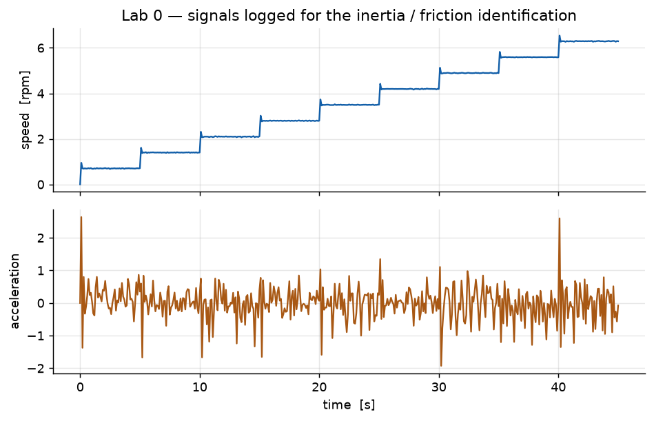
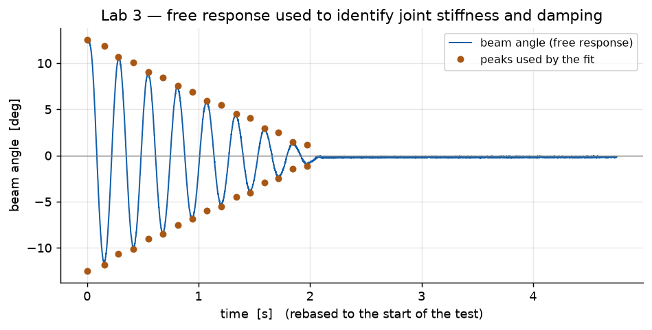
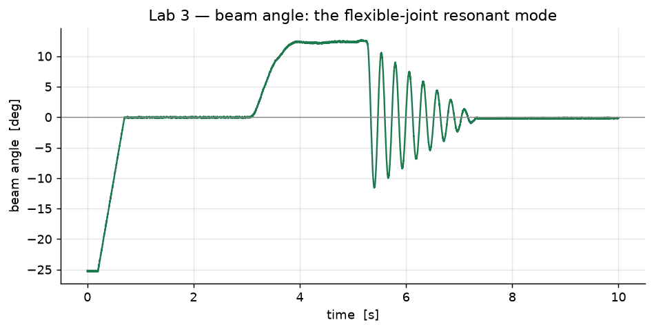
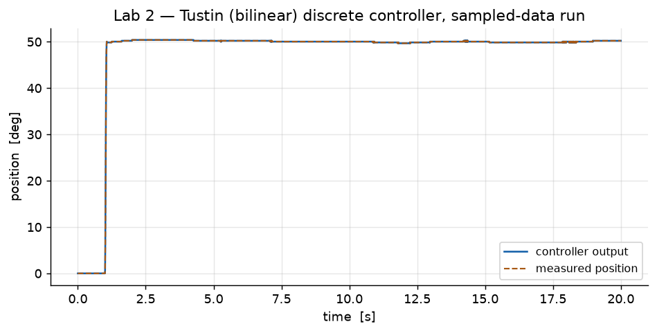
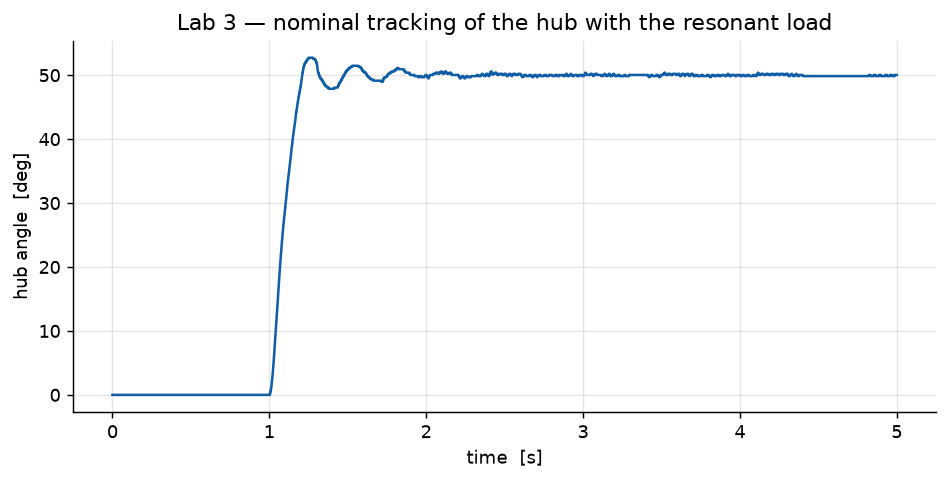

# Control Engineering Laboratory

Developed as part of academic coursework at the University of Padova, Italy.

Five laboratory implementations in classical and modern control, carried through
from plant modelling to controller design to experimental validation on real
hardware: frequency-domain PID, state-space pole placement, sampled-data control,
LQR, and experimental system identification.

**Hardware:** Quanser SRV-02 rotary servomotor (Faulhaber 2338S006S, 14:1 planetary
gearboxes, HEDS-5540 encoder, op-amp voltage driver) and a two-wheeled balancing
robot.
**Software:** MATLAB and Simulink with the Control System Toolbox.

---

## Overview

The five labs build one continuous argument. Each one adds a capability the
previous lab's controller does not have, and each one is validated on the physical
plant rather than only in simulation.

- **Lab 0** models the motor and identifies the parameters the datasheet omits.
- **Lab 1** abandons the PID design and rebuilds the controller in state space, in
  continuous time.
- **Lab 2** moves that controller into a digital implementation, by two different
  routes, and measures the cost of sampling.
- **Lab 3** changes the plant: a flexible coupling introduces a resonant mode, and
  two of the load parameters must now be identified from an experiment.
- **Lab 4** changes the plant completely — an unstable inverted pendulum that must
  be stabilised *and* positioned with a single input.

Reading them in order is the intended path; each lab's README states what it
depends on from the ones before it.

## Summary

| Lab | Topic | Core methods | Main implementation files |
|---|---|---|---|
| **0** | [Modelling and parameter identification](lab-0-modelling-and-identification/) | Bode-domain PID design; friction/inertia identification from a speed staircase | `Parameters.m`, `Avg_Am.m`, `Lab0.slx`, `Lab0_actual.slx` |
| **1** | [Continuous-time state-space tracking](lab-1-state-space-tracking/) | Anti-windup with back-calculation; friction/inertia feedforward; nominal tracking; integral action; internal model principle | `Lab1_Nom_Tracking.m`, `Lab1_Robust_Tracking.m`, `Lab1_Robust_Tracking_Error_Space.m`, 8 Simulink models |
| **2** | [Digital position control](lab-2-digital-control/) | Design by emulation (backward Euler / forward Euler / Tustin); direct digital design; reduced-order observer; discrete integral action; sampling-period study | `Lab_2_2_2.m`, `Lab_2_2_4.m`, `FF_DT.m`, `Lab2_*_Reduced_Order*.m`, 11 Simulink models |
| **3** | [Resonant load, LQR and identification](lab-3-resonant-load-lqr/) | Two-mass modelling; PID from Bode specifications; eigenvalue placement; LQR including Bryson's rule; **log-decrement identification of joint stiffness and damping** | `estimation.m`, `PID_Parameters.m`, `*_Resonant_Load*.m`, `position_SS_*.m`, 12 Simulink models |
| **4** | [Balancing robot](lab-4-balancing-robot/) | Nonlinear two-wheel pendulum model; linearisation; discrete LQR; integral-action augmentation | `BalRob_Params.m`, `Nominal_Tracking.m`, `Robust_Tracking.m`, 8 Simulink models |

## Methods used across the labs

**Controller design**

- *Frequency domain* — loop shaping on the Bode plot against settling-time and
  overshoot specifications, giving PID gains directly (Labs 0, 3).
- *Pole placement* — closed-loop eigenvalues placed on a constant-damping /
  constant-frequency locus, in continuous time via `place`/`acker` (Labs 1, 3) and
  in the z-domain after pole mapping through `z = exp(s·Ts)` (Labs 2, 4).
- *Linear Quadratic Regulator* — state weighting traded against control effort,
  including **Bryson's rule**, where each weight is the inverse square of an
  allowable state deviation or input limit so the weights are physical rather than
  tuned (Labs 3, 4).

**Robustness and disturbance rejection**

- *Integral action* on the tracking error, via an augmented plant
  `A_e = [0, C; 0, A]`, for zero steady-state error and rejection of constant
  disturbances (Labs 1, 2, 3, 4).
- *Internal model principle* — a resonant oscillator at the disturbance frequency
  appended to the plant, for rejection of time-varying references (Lab 1).
- *Anti-windup* by back-calculation with `Kw = 1/Tw` (Labs 1, 2, 3).
- *Feedforward compensation* using the identified inertia and friction, so the
  feedback loop does not have to discover them through error (Labs 1, 2).

**System identification**

- Equivalent inertia from the slope of torque against acceleration across a
  staircase of operating points (Lab 0).
- Joint stiffness and damping by the **log-decrement method** on a free response,
  fitted by least squares (Lab 3).

**Sampled-data implementation**

- Discrete equivalents by backward Euler, forward Euler and Tustin, compared
  against each other (Lab 2).
- Reduced-order observer for the unmeasured state (Lab 2).

## Repository structure

```
control-engineering-laboratory/
├── lab-0-modelling-and-identification/
│   ├── matlab/          parameter set, averaging and inertia estimate
│   ├── simulink/        plant model and hardware-run model
│   └── data/            logged signals from the identification run
├── lab-1-state-space-tracking/
│   ├── matlab/          nominal, integral-action and error-space designs
│   ├── simulink/        8 models: anti-windup, feedforward, nominal, robust
│   └── results/         captured step responses, simulation and hardware
├── lab-2-digital-control/
│   ├── matlab/          discretisation, observer, integral control
│   ├── simulink/        11 models across the discretisation and Ts study
│   ├── results/         captured sampling-period comparison
│   └── data/            logged controller output and measured position
├── lab-3-resonant-load-lqr/
│   ├── matlab/          identification, PID, pole placement, LQR
│   │   └── state-space/ the state-space and LQR design scripts
│   ├── simulink/        12 models including the hardware runs
│   └── data/            identification window and logged tracking responses
├── lab-4-balancing-robot/
│   ├── matlab/          robot parameters, linearisation, LQR designs
│   └── simulink/        8 nonlinear and linearised models
├── docs/
│   ├── SELECTION.md     what was included, what was excluded, and why
│   ├── CHANGES.md       every change made preparing this repository
│   ├── TEST_PLAN.md     what was checked, and what could not be
│   ├── figures/         figures regenerated from the logged data
│   └── SELECTION.md     also lists what was deliberately left out
├── tools/
│   ├── static_checks.py   12 integrity checks, no MATLAB needed
│   └── verify_designs.py  20 design checks: the controller arithmetic
│                          recomputed in Python and compared against the
│                          gains recorded in the MATLAB runs
├── requirements.txt     Python, for the figure and checking tools only
└── LICENSE
```

## Installation

MATLAB R2021a or later with **Simulink** and the **Control System Toolbox**. The
functions used are `place`, `acker`, `lqr`, `dlqr`, `c2d`, `ssdata`, `linsolve`,
`evalfr`, `lsqr`, `tfdata` and `zero` — all in the Control System Toolbox.

`requirements.txt` covers only the Python tooling used to regenerate the figures
and run the static checks from the logged CSV extracts; MATLAB is unaffected by it.

## Running the labs

Each lab is self-contained and is run from its own `matlab/` directory, because the
scripts and the Simulink models read their workspace variables from the shared
parameter file in that directory.

```matlab
% Lab 0
cd lab-0-modelling-and-identification/matlab;  Parameters

% Lab 1
cd lab-1-state-space-tracking/matlab;          Parameters; Lab1_Nom_Tracking

% Lab 2
cd lab-2-digital-control/matlab;               Parameters; Lab_2_2_2

% Lab 3  (identification first: it produces Estimated_Params.mat)
cd lab-3-resonant-load-lqr/matlab;             estimation_code; Parameters_Resonant_Load; PID_Parameters

% Lab 4
cd lab-4-balancing-robot/matlab;               Robust_Tracking
```

Then open the relevant `.slx` in `simulink/` and run it. The `*_Quanser.slx` and
`*_actual.slx` models drive the hardware and need the interface block described
below.

Two check suites need no MATLAB and are the fastest way to see whether the
mathematics holds up:

```bash
python tools/static_checks.py     # 12 integrity checks - files, exclusions, docs
python tools/verify_designs.py    # 20 design checks - recomputes the designs
```

`verify_designs.py` rebuilds the Lab 3 two-mass model and the pole-placement and
LQR designs in SciPy, and compares the results against the gains recorded in the
runs' own MATLAB workspaces. The nominal Lab 3 gain reproduces to six decimal
places. See [`docs/TEST_PLAN.md`](docs/TEST_PLAN.md).

## Results

Results come from three sources, and it matters which is which.

**Regenerated from the recorded logs.** These figures are drawn directly from the
signals logged during the runs, which are published alongside them as CSV extracts:











**Captured at the time of the experiment.** Lab 1 and Lab 2 include the step
response plots saved during the runs, in `results/`. Lab 1's are split between
`simulink/` and `physical-motor/`, so the simulation and hardware results can be
compared directly.

**Identified parameter values.** Read from the logged workspace of the Lab 3
identification run:

| Quantity | Value |
|---|---|
| Damping ratio `δ̂` | 0.0468 |
| Natural frequency `ω̂n` | 23.84 rad/s |
| Beam damping `B̂b` | 0.003124 N·m·s/rad |
| Joint stiffness `k̂` | 0.7955 N·m/rad |

No result in this repository is estimated, interpolated or reconstructed. Where a
result was not available it is absent and the limitation is stated.

## Course materials

The laboratory assignment briefs and the method handouts were supplied by the
course and are **the work of the course instructors, Riccardo Antonello and
Francesco Ticozzi (Department of Information Engineering, University of Padova)**.
Their objectives and models are described in the per-lab READMEs in this
repository's own words.

Those documents are **not redistributed here** and are not part of the published
repository. The assignment briefs cover: Lab 0 PID position control and parameter
estimation; Lab 1 state-space tracking control; Lab 2 digital position control;
Lab 3 position control with a resonant load; Lab 4 longitudinal control of the
balancing robot.

## Required but not included

The Simulink models that drive the physical hardware reference the Quanser DAQ
interface blocks:

```
SRV02IL_NIDAQ_block.slx      SRV02RL_NIDAQ_block.slx      balrob3d_block.slx
```

These are **third-party blocks supplied with the laboratory setup**, not written
for this coursework. Their redistribution terms are not established, so they are
deliberately **not** included. The pure-simulation models do not need them.

Consequently: every model in `simulink/` opens and runs as a simulation, but the
`*_Quanser.slx` and `*_actual.slx` models will report a missing block until those
files are added from a Quanser installation or the course material.

## Limitations

1. **Nothing here was executed on the machine that published it.** MATLAB and
   Simulink are not available on the host used to prepare this repository. Every
   claim about behaviour comes from the recorded runs or from the designs as
   written — see [`docs/TEST_PLAN.md`](docs/TEST_PLAN.md) for the precise split.
2. **The hardware models cannot run as shipped**, because of the DAQ blocks above.
3. **Raw `.mat` logs are not included.** The logged signals published here are CSV
   extracts of exactly the channels used in the figures; the full MATLAB workspaces
   stayed in the original archive.
4. **Lab 4 has no result figure.** The test data was saved as a MATLAB `.fig`
   rather than a portable image, and the signals were not re-exported at the time.
5. **Lab 1 and 2 results are captured images**, not regenerated plots, so they
   carry the axis ranges the author chose at the time.
6. **Simulink models are stored as `.slx`** (binary), so a reader without MATLAB
   cannot inspect their structure from this repository alone.

## Contributors and attribution

This is coursework, and parts of it were done in groups. What the material shows:

- **Lab 2** was submitted jointly — the archive contains the author's Lab 2 set
  under a folder naming both **Ali Shavakhi** and **Vaheid Labbaf**. Lab 2's
  material should be read as joint work.
- Labs 0, 1, 3 and 4 carry no joint-authorship marker in the archive.
- Material belonging to other students was present in the intake (folders named for
  a third student, and model files prepared for another). **None of it is published
  here** — see [`docs/SELECTION.md`](docs/SELECTION.md) for the full exclusion list.

The plant models follow the block-diagram structures given in the course handouts,
which is stated rather than implied. The identified parameters, the controller
designs, the identification methods and the Simulink implementations are the
author's own.

## Licence

Released under the **MIT Licence** — see [`LICENSE`](LICENSE).

No course-provided document, assignment brief or handout is covered by that
licence, and none is redistributed. Quanser-provided model blocks are not covered
and are not included.
