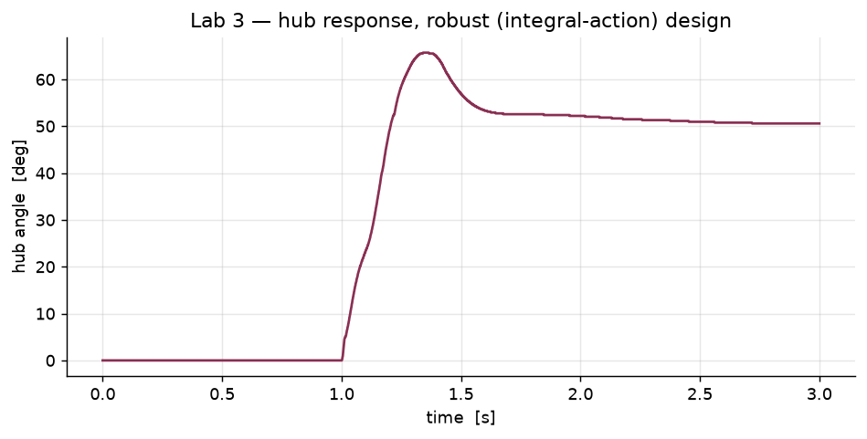

# Lab 3 — Position control with a resonant load

## Objective

The inertial disc of the earlier labs is replaced by a rigid beam joined to the
motor through a flexible coupling. The result is a **two-mass system with a
resonant mode** — the representative model of essentially every motion system with
an elastic transmission.

Two things have to be done:

1. control the hub position in the presence of the resonance, using both PID and
   state-space methods, with the state-space design done both by eigenvalue
   placement and by LQR;
2. **identify** the two parameters that describe the joint — the beam damping
   coefficient `Bb` and the joint stiffness `k` — from an experimental free
   response.

## Plant

| Parameter | Value | Source |
|---|---|---|
| Hub inertia `Jh` | 6.84 × 10⁻⁴ kg·m² | given (aluminium hub) |
| Beam inertia `Jb` | 1.4 × 10⁻³ kg·m² | given |
| Joint stiffness `k` | to be estimated | **identified here** |
| Beam damping `Bb` | to be estimated | **identified here** |

The fourth-order model has states `[θh, θb, ωh, ωb]` — hub angle, beam angle, and
their rates — with the coupling through `k` and `Bb`.

## Identification — log-decrement method

With the hub held, the beam is given an initial displacement and released. The
resulting free response is a decaying oscillation whose envelope is exponential:

```
θb(t) ≈ e^(−δωn t) · cos(ωd t + φ)
```

Taking the logarithm of successive peak amplitudes turns this into a straight line
in the peak index. `estimation_code.m` builds that regression explicitly:

```
Y = log(peaks),   Φ = [−peak_index, 1]
ThLs = lsqr(ΦᵀΦ, ΦᵀY)        →   δ̂  (the slope)
```

The damped frequency is obtained from the inter-peak times, `ω̂d = π/Δt`, and the
natural frequency from `ω̂n = ω̂d / √(1 − δ̂²)`. The joint parameters then follow
directly from the beam inertia:

```
B̂b = Jb · 2δ̂ω̂n            k̂ = Jb · ω̂n²
```

**Identified values**, read from the recorded logs of the run:

| Quantity | Value |
|---|---|
| Damping ratio `δ̂` | 0.0468 |
| Damped frequency `ω̂` | 23.81 rad/s |
| Natural frequency `ω̂n` | 23.84 rad/s |
| Beam damping `B̂b` | 0.003124 N·m·s/rad |
| Joint stiffness `k̂` | 0.7955 N·m/rad |

The joint is light — δ ≈ 0.047 — so the resonance is sharp, which is exactly why
it has to be identified rather than assumed.

## Control design

**PID from Bode specifications.** `PID_Parameters.m` builds the simplified
transfer function from the motor and load parameters, then computes Kp, Kd, Ti, Ki
from a gain crossover `wgc` derived from the settling-time and overshoot
specification, using the phase-margin relation `phim = atan(2δ/√(√(1+4δ²) − 2δ²))`
and a lead ratio `α = 4`. Anti-windup is added with `Tw = ts/5`.

**State-space by eigenvalue placement.** `Nom_Tracking_Resonant_Load.m` places four
poles on a constant-ζ / constant-ωn locus and computes the feedforward gains from
the augmented steady-state problem. The identified `k̂` and `B̂b` enter the model
through `Parameters_Resonant_Load.m`, so the design uses the measured joint rather
than a guessed one.

**Robust tracking.** `Rob_Tracking_Resonant_Load.m` augments the plant with the
integral of the error and places the five poles of the augmented system.

**LQR.** Two weightings are compared:

- `LQR_Nom_Tracking_Resonant_Load.m` — `Q = CᵀC`, a single scalar weight `r`
  traded against position error, and the closed-loop pole locus of
  `1 + (1/r)·Gᵀ(−s)G(s)` plotted as the weight is varied;
- `LQR_Nom_Tracking_Resonant_Load_Bryson.m` — **Bryson's rule**, normalising each
  state by its allowable value and the input by its limit, so the weights carry
  physical meaning instead of being tuned by hand.

The same experiment is then repeated on the hardware (`*_Quanser.slx`), where the
identified parameters matter even more because the real joint is not the nominal
one.

## Files

| File | Role |
|---|---|
| `matlab/Parameters_Resonant_Load.m` | Plant parameters with the two-mass load; loads the estimate |
| `matlab/PID_Parameters.m` | PID design from Bode specifications |
| `matlab/estimation.m` | Peak extraction and the log-decrement regression |
| `matlab/estimation_code.m` | The same, with the explicit least-squares solve and the `Bb`/`k` recovery |
| `matlab/Nom_Tracking_Resonant_Load.m` | Nominal state-space design |
| `matlab/Rob_Tracking_Resonant_Load.m` | Robust (integral-action) design |
| `matlab/LQR_*_Resonant_Load*.m` | LQR with scalar weight and with Bryson's rule |
| `matlab/state-space/position_SS_2_3_*.m` | Pole-placement design on the state-space model |
| `matlab/state-space/position_SS_2_4_*.m` | LQR, Bryson-weighted LQR, and LQR with integral action |
| `simulink/ResLoad_{Nom,Rob}.slx` | Pole-placement designs against the resonant plant |
| `simulink/LQR_{,Br_}ResLoad_Nom.slx` | LQR designs |
| `simulink/Resonant_Load_PID.slx` | PID against the resonant plant |
| `simulink/Lab3_2_4_*.slx` | LQR weighting study |
| `simulink/DCServomotorWResLoad_*_Quanser.slx` | Hardware runs |
| `data/identification_window.csv` | The free-response window the fit uses |
| `data/tracking_{nominal,robust}.csv`, `data/resonant_mode.csv` | Logged responses |

## Results


The free response with the sixteen peaks the log-decrement fit is built from. The
envelope decays cleanly and monotonically, which is what makes the regression valid.


The beam angle during the tracking run: the flexible joint oscillates while the hub
follows its reference. This is the mode the controller has to avoid exciting.




Hub position for the nominal and the robust (integral-action) designs.

## Running it

```
cd lab-3-resonant-load-lqr/matlab
matlab -batch "estimation_code"                    % identification
matlab -batch "Parameters_Resonant_Load; PID_Parameters; Nom_Tracking_Resonant_Load"
```

`Parameters_Resonant_Load.m` loads `Estimated_Params.mat` (the identification
output), so `estimation_code.m` must be run first to regenerate it.

Requires MATLAB, Simulink and the Control System Toolbox (`acker`, `lqr`, `linsolve`,
`evalfr`). Not executed on this host — see `docs/TEST_PLAN.md`.
